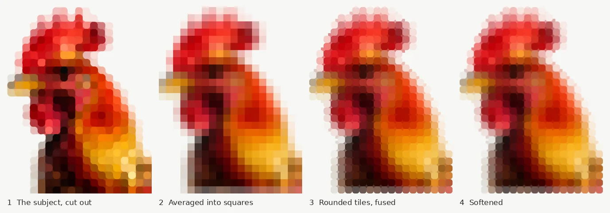

# Rounded-pixel art

The picture on the welcome screen is a rooster made of big, soft, rounded
squares. This is how that kind of picture is built, how to make another one
from any image, and how to put it in the app with the same arrival
animation.



The tool is [`scripts/rounded_pixels.py`](../scripts/rounded_pixels.py)
(Pillow and numpy, nothing else). The widget is
[`app/lib/widgets/rooster_art.dart`](../app/lib/widgets/rooster_art.dart).

---

## 1. What the style is

A picture reduced to a coarse grid of squares, each one a single colour,
with every square's corners rounded off. Neighbouring squares of one colour
fuse into soft blobs, squares of different colours round off against each
other, and the outline of the subject is a row of bumps rather than a
staircase.

It sits between pixel art and a mosaic. It reads as a picture at a glance,
because at twenty squares across the eye fills the detail in. Up close it
reads as a pattern, which is why it can go behind the status bar and
under a sheet of buttons without fighting them.

Four things make it this style rather than just "pixelated":

| Property | In the rooster | Why it matters |
|:--|:--|:--|
| **Coarse grid** | 20 squares across, 25 down | Few enough squares that each one is a decision. More than about 28 across and it turns back into a blurry photo. |
| **Rounded corners** | radius 36% of a square | Turns a staircase outline into a soft, friendly one. Below 25% it looks like plain pixels; above 45% the squares read as dots. |
| **Fusing** | corner gaps filled with the mean of the squares around them | Same-coloured neighbours become one shape, so the eye sees a comb and a wattle rather than 335 tiles. |
| **A halo** | squares on the outline are pale tints | Each square is the average of what it covers, so one that is half bird and half background comes out as a tint of the bird. The outline fades rather than stops. |

---

## 2. The rooster, measured

The rooster was supplied as finished art; nothing about it was invented
here. Everything below was measured from the file
(`app/lib/assets/rooster.webp`) so the app could animate it.

| | |
|:--|:--|
| Canvas | 1121 x 1403 px |
| Ground | `#F6F7F4`, a warm off-white -- not white, which would glare |
| Grid | 20 x 25 squares, pitch 56.2 x 55.7 px (very nearly square) |
| Grid origin | (-10.04, 14.9): the first column starts just off the left edge |
| Squares holding the bird | 335 of 500 |
| Focal square | the eye, row 8, column 8 -- the darkest square in the head |
| Composition | facing left, into empty space; cropped by the right and bottom edges at the shoulder |
| Palette | reds from near-black to coral, oranges and yellows on the neck, one ochre beak; nothing cool except the off-white |

### The crop is part of the design

The bird is cropped, not floating. Its body runs off the right and bottom
edges and only the head is complete. That is what makes it a portrait rather
than a sticker, and it is why the app lets the bottom of the picture go
under the buttons: the bird is meant to continue past the frame.

---

## 3. Choosing and preparing a subject

The method will turn anything into squares. Whether the result is any good
is decided before it runs.

**A strong silhouette.** Hold the source at arm's length and squint. If it
is still recognisable as a blob, it will survive. A rooster's comb, a cat's
ears, a bicycle's wheels survive; a crowd, a landscape or a face seen
straight on mostly do not.

**One focal point.** Something small and dark or bright where the eye lands
first -- the rooster's eye. The arrival animation grows out from it, and the
script suggests the darkest square in the upper half. Override it if the
subject's focal point is somewhere else.

**Colour that is not the ground's.** Averaging greys colours out, and a pale
subject on a pale ground loses its edges entirely: a white shirt or fair
skin against `#F6F7F4` turns into a ghost. Prefer saturated, mid-to-dark
subjects, and use `--vivid 1.2` to `1.4` on photographs to win back what
averaging takes.

**Detail at the right size.** At 20 squares across, a square is 5% of the
width. A feature smaller than one square becomes a single tint or vanishes.
The rooster's eye is exactly one square -- which is why it works as the focal
point. If the thing that matters is smaller than that, crop tighter or use
more columns.

**Face into the space.** The subject should look or move towards the empty
side of the frame. On the welcome screen that is the left, with the subject
anchored top right.

**Cut it out.** Remove the background before anything else: any background
remover, saved as a PNG with transparency. The script can guess a backdrop
by flooding in from the edges of the picture, but only a plain, evenly lit
one; a wall with a shadow on it, or a floor and a wall, will come out as
squares.

---

## 4. Making one

```bash
pip install pillow numpy
python3 scripts/rounded_pixels.py cutout.png lib/assets/hero.webp \
  --columns 20 --cropped bottom,right --stages /tmp/hero-steps
```

It writes the picture (lossless WebP), `hero.json` beside it with the grid
the app needs, and with `--stages`, one PNG per step to see where something
went wrong.

### What it does

1. **Cut out.** The PNG's own transparency, or the flood-filled guess.
   `--cropped` names the edges the subject runs off, so the guess does not
   flood in from there and eat it.
2. **Laid on the ground and averaged.** The subject is composited over the
   ground colour, then each square becomes the mean of what it covers (a box
   filter: exactly "the average of the square", no sharpening). Edge squares
   come out as tints -- the halo.
3. **Thresholded.** Squares the subject covers less than `--cover` of
   (18%) are dropped to the ground, so a stray hair does not leave a lone
   pale square.
4. **Drawn as rounded tiles, fused.** First every grid corner where three or
   four filled squares meet is filled with their mean colour; then each
   square is drawn over it as a rounded tile. Where three or four meet the
   corner is filled and neighbours fuse. Where only one or two meet -- a
   corner of the outline -- it is left to the ground, which is what rounds
   the outline into bumps.
5. **Drawn four times over and scaled down,** then blurred by `--softness`
   (3.5% of a square). The blur is what makes it read as soft rather than
   vector-crisp; more than 6% and it reads as out of focus.

### The settings

| Option | Default | Raise it when | Lower it when |
|:--|:--|:--|:--|
| `--columns` | 20 | the focal detail is smaller than one square | it looks like a blurry photo rather than squares |
| `--roundness` | 0.36 | it reads as plain pixels | the squares read as separate dots |
| `--softness` | 0.035 | edges look cut out with scissors | it looks out of focus |
| `--cover` | 0.18 | stray pale squares hang off the outline | the outline is losing thin parts (a beak, a tail) |
| `--vivid` | 1.0 | a photograph comes out grey | colours go neon |
| `--pitch` | 56.2 | -- | -- (the output's resolution: a square in pixels; 56 gives a ~1100 px wide picture, sharp on any phone) |
| `--ground` | F6F7F4 | -- | -- (change it only with the screen's own ground) |

### Common problems

| What you see | What it is | Fix |
|:--|:--|:--|
| The whole backdrop came out as squares | the guess could not find a plain backdrop | cut the subject out first |
| A bite out of the bottom of a bust | the guess flooded in from an edge the subject runs off | `--cropped bottom` |
| A pale ghost of a face | pale subject on a pale ground | `--vivid 1.3`; or choose a darker subject |
| Lone pale squares around the outline | backdrop specks the cut-out missed | raise `--cover`, or clean the cut-out |
| The focal point is not where the animation starts | the darkest square in the upper half is somewhere else | set the eye by hand in the app (section 5) |

### Judge it at the size it will be seen

Look at the result at phone size -- about 380 points wide -- before anything
else. The style is built to be seen small; at full size on a monitor every
version looks wrong.

---

## 5. Putting it in the app

### The file

- Lossless WebP. The rooster is 832 KB at 1121 x 1403. Lossy compression
  smears the ground into the tiles at the soft edges; the size is worth it
  for a picture that is the first thing anybody sees.
- In `app/lib/assets/`, and listed under `flutter: assets:` in
  `app/pubspec.yaml`.
- On its own ground colour, in both themes. It is a picture, not a surface,
  and inverting it for dark mode would be a different picture.

### The constants

`RoosterArt` carries the measurements as constants. For a new picture they
come from the script's JSON:

| In `rooster_art.dart` | From the JSON | Notes |
|:--|:--|:--|
| `asset` | -- | the file's path |
| `ground` | `ground` | also the welcome screen's light-mode background |
| `imageSize` | `imageSize` | |
| `pitch` | `pitch` | |
| `gridOrigin` | `gridOrigin` | (0, 0) for the script's output |
| `squares` | `squares` | one string per row, `#` for a filled square |
| `eye` | `eye` | where the arrival starts; set it by hand if the script's guess is wrong |
| `_headDepth` | -- | the foot of the last row that must always be on screen: `gridOrigin.dy + rows * pitch.height`. For the rooster, 18 rows, the end of the wattles |

### Layout

- **Anchored top right,** as wide as the frame, and never so big that the
  first `_headDepth` of the picture stops fitting (`RoosterArt.layout`). A
  wide window gets a smaller picture on the right rather than a close-up.
- **Cut between two rows.** Whatever sits under the picture meets it with a
  straight edge, and the frame's height is brought up to the nearest line
  between two rows of squares (`RoosterArt.fitHeight`). An edge through the
  middle of a row leaves a line of half-squares along it, which reads as a
  mistake.
- **No card, no shadow.** In light mode the buttons sit on the picture's own
  ground, so the edge between them exists only where the subject is. In
  dark mode the picture keeps its colours, so the edge is the full width --
  a photograph above the page.
- **Status bar icons dark** over the light ground in either theme
  (`AnnotatedRegion`), or they are white on off-white.

### The animation

The squares arrive from the focal square outward, hold, leave the way they
came, and arrive again.

| | | |
|:--|:--|:--|
| Arriving | 1.4 s | each square grows from 55% to full size and fades in over 45% of the arrival, `easeOutCubic`, starting later the further it is from the eye |
| Settling | last 15% of the arrival | the exact picture fades in over the tiles, so the soft outline the tiles cut off comes in without a jump |
| Holding | 4.2 s | a timer, not an animation, so nothing repaints while it stands still |
| Leaving | 1.1 s | the arrival played backwards: the picture gives way to tiles, the edges go first, the eye last |
| Resting | 0.3 s | the empty ground, one breath |

The tiles are drawn as a mask (rounded squares, corner radius 36% of a
square, 6% oversize so tiles that have landed meet with no seam) and the
picture is drawn through it (`BlendMode.srcIn`), so every tile shows exactly
the art's own pixels.

Nothing moves for anybody whose phone asks for less motion
(`MediaQuery.disableAnimationsOf`): the picture is just there, and stays.

---

## 6. Before it ships

- [ ] Recognisable at 380 points wide, in a two-second glance.
- [ ] The focal point is one square, and the arrival starts there.
- [ ] The frame never cuts the part that matters, on a small phone
      (360 x 640) and a desktop window (`get_started_test.dart` checks the
      rooster's).
- [ ] The cut under the picture falls between rows.
- [ ] Light and dark mode both looked at.
- [ ] Under a megabyte.
- [ ] The rights are yours (below).

## 7. Rights

The method is free to use; a picture made with it is a copy of its source.
Run it on your own photographs, commissioned art, or images whose licence
allows derivatives and commercial use. A pixelated copy of somebody else's
photograph is still their photograph. The rooster was supplied as finished
art for this app; confirm its rights the same way before a public release.

## 8. Why the rooster is an image and not code

The first version drew the squares from their sampled colours with rounded
rectangles. Every model tried -- blurred, overlapped, fused with a median --
came out noisier than the art, because the art's fusing is irregular in ways
a rule does not reproduce: the step-4 picture above is close, but it is
visibly not the original. So the art ships as itself, pixel for pixel, and
the code only animates it: the grid it measures is used to cut the tiles
the picture arrives through, never to redraw it.

The script exists for the next picture, where there is no finished art to
ship -- and where close to the rooster, and consistent with it, is exactly
what is wanted.
